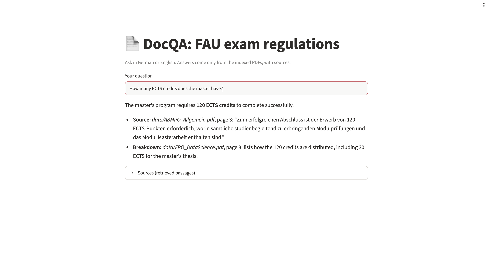
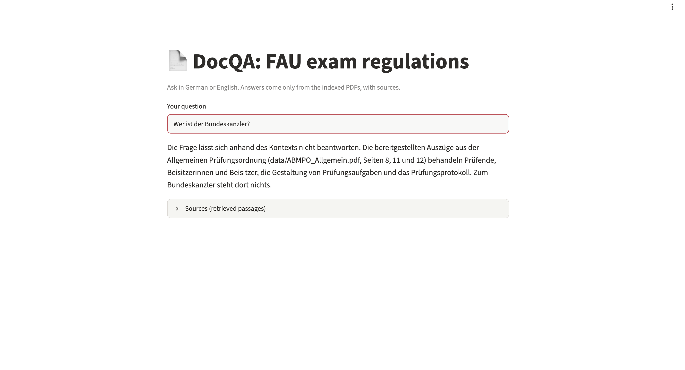
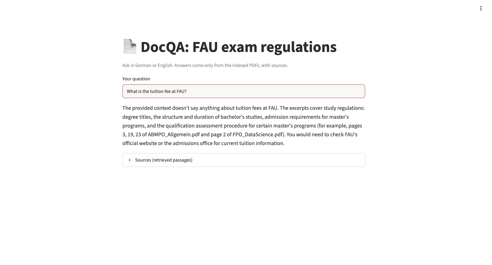

# DocQA: RAG assistant for German university regulations

Ask questions in German or English about FAU exam regulations and get answers with the source document and page. If the answer isn't in the documents, it says so instead of guessing.



## How it works
1. **Ingest:** PDFs are split into chunks (800 characters, 100 overlap) and embedded with a local multilingual model (`paraphrase-multilingual-MiniLM-L12-v2`).
2. **Retrieve:** the 4 most similar chunks are fetched from a Chroma vector database.
3. **Generate:** Claude answers only from those chunks and cites document and page.

## Stack
Python, LangChain, Chroma, sentence-transformers, Claude (Anthropic API), Streamlit

## Run it
```bash
python -m venv venv && source venv/bin/activate
pip install -r requirements.txt
echo "ANTHROPIC_API_KEY=your-key" > .env
# put PDFs in data/
python src/ingest.py
python -m streamlit run app.py
```

## Examples
| Question | Behavior |
|---|---|
| How many ECTS credits does the master have? (English, German documents) | Answers with citation |
| Wer ist der Bundeskanzler? | Says it's not in the documents |
| What is the tuition fee at FAU? | Says it's not in the documents |




## Limitations
- Demo built on the 2020/2022 consolidated FAU regulations. Check FAU's website for current rules.
- Basic fixed-size chunking, no reranking, no formal evaluation yet.

## Next steps
- Evaluation set with faithfulness and answer-relevance metrics
- Hybrid search (BM25 + vectors) and reranking
- FastAPI service, Docker, Prometheus/Grafana monitoring
